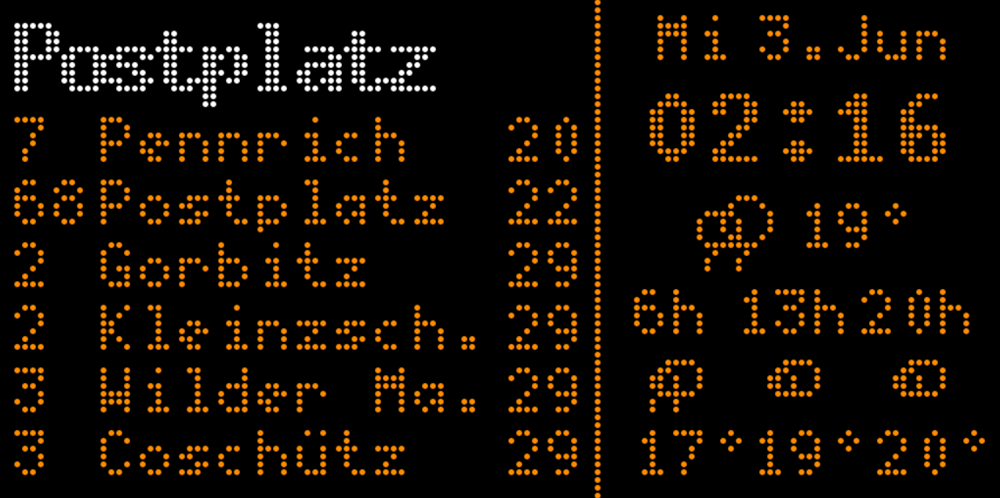

# Dresden Departures Board (LEDMatrix plugin)

Dresden tram and bus departure display for [ChuckBuilds LEDMatrix](https://github.com/ChuckBuilds/LEDMatrix).

**Left ~60%:** station name + tram departures (line / destination / minutes)  
**Right ~40%:** date, clock, current temp + icon, then three forecast columns for the **next upcoming** 6h / 13h / 20h slots

Designed for **128×64** panels (e.g. four 64×32 tiles). Other sizes may work but layout is tuned for that resolution.



## How it works

1. **`update()`** (every `update_interval`, default 15 s) — resolves your stop via VVO pointfinder, fetches departures from the VVO departure monitor, and loads weather from Open-Meteo. Weather is cached for 10 minutes.
2. **`display()`** (each frame) — composes a PIL image with BDF bitmap fonts. Redraws when the minute, departures, or weather changes; otherwise reuses the cached frame.

No API keys.

## Data sources

| Data | API |
|------|-----|
| Departures | [VVO WebAPI](https://webapi.vvo-online.de/) (`tr/pointfinder` + `dm`, same endpoints as [dvbpy](https://github.com/offenesdresden/dvbpy)) |
| Weather | [Open-Meteo](https://open-meteo.com/) |

## Installation

Install via the LEDMatrix web UI (**Plugin Manager → Install from GitHub**), then enable the plugin, set your stop, and restart the display service.

For a local clone, see the [LEDMatrix plugin development docs](https://github.com/ChuckBuilds/LEDMatrix/blob/main/docs/PLUGIN_DEVELOPMENT_GUIDE.md).

## Finding your stop in VVO API

Just use a **stop name** and a bit of code (similar to the implementation in [dvbpy](https://github.com/offenesdresden/dvbpy)) will find the **numeric VVO stop ID**.

| Input | Resolves to |
|-------|-------------|
| `Postplatz` | Dresden Postplatz (`33000037`) |
| `Postplatz, Dresden` | Same (city suffix optional) |
| `33000037` | Used directly |

## Configuration

Non-secret options live in `config/config.json` under the `ledmatrix-dresden-departures` key (web UI plugin tab).

| Option | Default | Description |
|--------|---------|-------------|
| `enabled` | `true` | Enable plugin |
| `update_interval` | `15` | Seconds between departure API refreshes |
| `tram_only` | `true` | Hide buses, show trams only |
| `max_departures` | `6` | Departure rows (up to ~7 on 64 px height) |
| `display_duration` | `86400` | Seconds on screen (86400 = all day) |
| `timezone` | `Europe/Berlin` | Clock / departure timezone |
| `weather_at_stop` | `true` | Weather at stop coords from VVO (recommended) |
| `latitude` / `longitude` | Dresden area | Fallback when `weather_at_stop` is false or coords unavailable |
| `sidebar_percent` | `40` | Right panel width (date / time / weather) as % of display |

**Refresh timing:** Departures refetch every `update_interval` seconds. The clock redraws every minute. Weather refetches every 10 minutes.

Example `config.json` (no secrets):

```json
{
  "ledmatrix-dresden-departures": {
    "enabled": true,
    "update_interval": 15,
    "tram_only": true,
    "max_departures": 6,
    "display_duration": 86400,
    "sidebar_percent": 40,
    "weather_at_stop": true,
    "timezone": "Europe/Berlin",
    "latitude": 51.0504,
    "longitude": 13.7373
  }
}
```

Set `enabled` to `false` in all other plugin configs (or set very short durations) if you want this view permanently.

## Private stop / secrets file

`stop_id` and `stop_name` are stored in `config/config_secrets.json` (gitignored). VVO and Open-Meteo need no API keys.

```json
{
  "ledmatrix-dresden-departures": {
    "stop_id": "Postplatz",
    "stop_name": "Postpl."
  }
}
```

`stop_id` is resolved via the VVO API (name or numeric ID). `stop_name` is the short label shown in the header.

## Requirements

- LEDMatrix >= 2.0.0
- Network access from the Pi
- Python stdlib + Pillow (included with LEDMatrix)
- **freetype-py** — BDF bitmap fonts (usually installed with LEDMatrix)
- **pyproj** — optional but recommended; converts VVO GK4 stop coordinates to WGS84 for `weather_at_stop`

## Development

This plugin was built with substantial help from [Cursor](https://cursor.com) **Composer 2.5**. The author tested everything on real hardware; treat issues as normal open-source feedback.

## License

GPL-3.0-or-later (same as LEDMatrix plugins)
